# The sprites

<!-- Generated by tools/sprites.py: edit that, not this page. -->

The game draws everything but the walls of the views and the status
panel through `plot_sprite`, by sprite number: 120 sprites, named in the
listings by number (`spr_` constants where the code names one). Each sprite's data address, width in
bytes and height in rows are in four tables of 120 bytes,
[`sprite_addr_lo`](address:1AE0@disc?hex),
[`sprite_addr_hi`](address:1B58@disc?hex),
[`sprite_widths`](address:1BD0@disc?hex) and
[`sprite_heights`](address:1C48@disc?hex). The data is stored row by
row, each byte two MODE 2 pixels (the left pixel's colour in bits 7, 5,
3 and 1, the right's in bits 6, 4, 2 and 0), and is stored over the
screen rather than masked, so black is drawn as black.

This is the official disc's Model B set as the game starts; the tables
and the sprite data are the same in Ole's crack and the sideways RAM
hack. The tables change while the game runs: a hero going down the exit
shrinks their own sprites, and the victory sequence changes some entries
and data. The wall sprite,
&00, is replaced by each level's own (bytes &280-&2AF of the level file;
see [level-format.md](level-format.md)); the one shown is level 1's.
Several numbers share data: the twelve drainer sprites are one picture,
and &15, &1A and &77 are the blank sprite.

The pictures use the default MODE 2 palette, which the game never
changes, with each pixel twice as wide as it is tall, as on the screen.
A sprite marked *flashing* uses one of colours 8-15, which alternate
between two colours; it is drawn in the first.

| No. | Sprite | Name | Size (pixels) | Data |
|---|---|---|---|---|
| &00 | 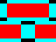 | `wall` | 8×12 | [`wall_sprite`](address:2D00@disc?hex) |
| &01 | 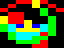 | `ranger_up_0` | 8×12 | [`sprite_ranger_up_0`](address:2D30@disc?hex) |
| &02 |  | `ranger_up_1` | 8×12 | [`sprite_ranger_up_1`](address:2D60@disc?hex) |
| &03 | 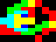 | `ranger_right_0` | 8×12 | [`sprite_ranger_right_0`](address:2D90@disc?hex) |
| &04 | 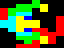 | `ranger_right_1` | 8×12 | [`sprite_ranger_right_1`](address:2DC0@disc?hex) |
| &05 | 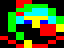 | `ranger_down_0` | 8×12 | [`sprite_ranger_down_0`](address:2DF0@disc?hex) |
| &06 | 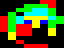 | `ranger_down_1` | 8×12 | [`sprite_ranger_down_1`](address:2E20@disc?hex) |
| &07 | 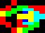 | `ranger_left_0` | 8×12 | [`sprite_ranger_left_0`](address:2E50@disc?hex) |
| &08 | 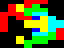 | `ranger_left_1` | 8×12 | [`sprite_ranger_left_1`](address:19C0@disc?hex) |
| &09 |  | `monster_up_0` | 8×12; *flashing* 11 (yellow/blue) | [`sprite_monster_up_0`](address:2E80@disc?hex) |
| &0A | 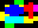 | `monster_up_1` | 8×12; *flashing* 11 (yellow/blue) | [`sprite_monster_up_1`](address:2EB0@disc?hex) |
| &0B | 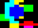 | `monster_right_0` | 8×12; *flashing* 11 (yellow/blue) | [`sprite_monster_right_0`](address:2EE0@disc?hex) |
| &0C | 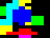 | `monster_right_1` | 8×12; *flashing* 11 (yellow/blue) | [`sprite_monster_right_1`](address:2F10@disc?hex) |
| &0D |  | `monster_down_0` | 8×12; *flashing* 11 (yellow/blue) | [`sprite_monster_down_0`](address:2F40@disc?hex) |
| &0E | 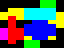 | `monster_down_1` | 8×12; *flashing* 11 (yellow/blue) | [`sprite_monster_down_1`](address:2F70@disc?hex) |
| &0F |  | `monster_left_0` | 8×12; *flashing* 11 (yellow/blue) | [`sprite_monster_left_0`](address:2FA0@disc?hex) |
| &10 | 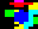 | `monster_left_1` | 8×12; *flashing* 11 (yellow/blue) | [`sprite_monster_left_1`](address:2FD0@disc?hex) |
| &11 | 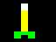 | `arrow_up` | 8×12 | [`sprite_arrow_up`](address:2C00@disc?hex) |
| &12 |  | `arrow_right` | 8×12 | [`sprite_arrow_right`](address:2C30@disc?hex) |
| &13 |  | `arrow_down` | 8×12 | [`sprite_arrow_down`](address:2C60@disc?hex) |
| &14 |  | `arrow_left` | 8×12 | [`sprite_arrow_left`](address:2C90@disc?hex) |
| &15 |  | `blank` | 8×12 | [`sprite_blank`](address:04CF@disc?hex) |
| &16 |  | `sparkle_0` | 8×12 | [`sprite_sparkle_0`](address:2B00@disc?hex) |
| &17 |  | `sparkle_1` | 8×12 | [`sprite_sparkle_1`](address:2B30@disc?hex) |
| &18 |  | `sparkle_2` | 8×12 | [`sprite_sparkle_2`](address:2B60@disc?hex) |
| &19 |  | `sparkle_3` | 8×12 | [`sprite_sparkle_3`](address:2B90@disc?hex) |
| &1A |  | `blank_key_icon` | 4×3 | [`sprite_blank`](address:04CF@disc?hex) |
| &1B |  | `key` | 8×12 | [`sprite_key`](address:2900@disc?hex) |
| &1C |  | `door_vertical` | 8×12 | [`sprite_door_vertical`](address:2CC0@disc?hex) |
| &1D |  | `door_horizontal` | 8×12 | [`sprite_door_horizontal`](address:2AC8@disc?hex) |
| &1E |  | `digit_0` | 4×10 | [`sprite_digit_0`](address:2A00@disc?hex) |
| &1F |  | `digit_1` | 4×10 | [`sprite_digit_1`](address:2A14@disc?hex) |
| &20 |  | `digit_2` | 4×10 | [`sprite_digit_2`](address:2A28@disc?hex) |
| &21 |  | `digit_3` | 4×10 | [`sprite_digit_3`](address:2A3C@disc?hex) |
| &22 |  | `digit_4` | 4×10 | [`sprite_digit_4`](address:2A50@disc?hex) |
| &23 |  | `digit_5` | 4×10 | [`sprite_digit_5`](address:2A64@disc?hex) |
| &24 |  | `digit_6` | 4×10 | [`sprite_digit_6`](address:2A78@disc?hex) |
| &25 |  | `digit_7` | 4×10 | [`sprite_digit_7`](address:2A8C@disc?hex) |
| &26 |  | `digit_8` | 4×10 | [`sprite_digit_8`](address:2AA0@disc?hex) |
| &27 |  | `digit_9` | 4×10 | [`sprite_digit_9`](address:2AB4@disc?hex) |
| &28 | 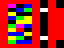 | `treasure` | 8×12; *flashing* 11 (yellow/blue), 12 (blue/yellow) | [`sprite_treasure`](address:2930@disc?hex) |
| &29 |  | `food` | 8×12 | [`sprite_food`](address:2960@disc?hex) |
| &2A |  | `cross` | 8×12 | [`sprite_cross`](address:0AF0@disc?hex) |
| &2B |  | `teleporter` | 8×12 | [`sprite_teleporter`](address:29C0@disc?hex) |
| &2C | 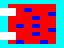 | `trapdoor` | 8×12 | [`sprite_trapdoor`](address:2BC0@disc?hex) |
| &2D | 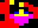 | `magic_user_up_0` | 8×12 | [`sprite_magic_user_up_0`](address:2300@disc?hex) |
| &2E |  | `magic_user_up_1` | 8×12 | [`sprite_magic_user_up_1`](address:2330@disc?hex) |
| &2F | 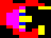 | `magic_user_right_0` | 8×12 | [`sprite_magic_user_right_0`](address:2360@disc?hex) |
| &30 | 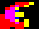 | `magic_user_right_1` | 8×12 | [`sprite_magic_user_right_1`](address:2390@disc?hex) |
| &31 |  | `magic_user_down_0` | 8×12 | [`sprite_magic_user_down_0`](address:23C0@disc?hex) |
| &32 | 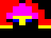 | `magic_user_down_1` | 8×12 | [`sprite_magic_user_down_1`](address:23F0@disc?hex) |
| &33 | 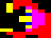 | `magic_user_left_0` | 8×12 | [`sprite_magic_user_left_0`](address:2420@disc?hex) |
| &34 | 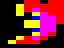 | `magic_user_left_1` | 8×12 | [`sprite_magic_user_left_1`](address:2450@disc?hex) |
| &35 | 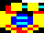 | `barbarian_up_0` | 8×12 | [`sprite_barbarian_up_0`](address:2480@disc?hex) |
| &36 | 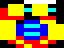 | `barbarian_up_1` | 8×12 | [`sprite_barbarian_up_1`](address:24B0@disc?hex) |
| &37 | 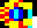 | `barbarian_right_0` | 8×12 | [`sprite_barbarian_right_0`](address:24E0@disc?hex) |
| &38 | 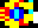 | `barbarian_right_1` | 8×12 | [`sprite_barbarian_right_1`](address:2510@disc?hex) |
| &39 | 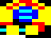 | `barbarian_down_0` | 8×12 | [`sprite_barbarian_down_0`](address:2540@disc?hex) |
| &3A | 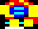 | `barbarian_down_1` | 8×12 | [`sprite_barbarian_down_1`](address:2570@disc?hex) |
| &3B |  | `barbarian_left_0` | 8×12 | [`sprite_barbarian_left_0`](address:25A0@disc?hex) |
| &3C | 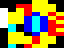 | `barbarian_left_1` | 8×12 | [`sprite_barbarian_left_1`](address:25D0@disc?hex) |
| &3D |  | `fighter_up_0` | 8×12 | [`sprite_fighter_up_0`](address:2600@disc?hex) |
| &3E |  | `fighter_up_1` | 8×12 | [`sprite_fighter_up_1`](address:2630@disc?hex) |
| &3F |  | `fighter_right_0` | 8×12 | [`sprite_fighter_right_0`](address:2660@disc?hex) |
| &40 |  | `fighter_right_1` | 8×12 | [`sprite_fighter_right_1`](address:2690@disc?hex) |
| &41 |  | `fighter_down_0` | 8×12 | [`sprite_fighter_down_0`](address:26C0@disc?hex) |
| &42 | 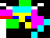 | `fighter_down_1` | 8×12 | [`sprite_fighter_down_1`](address:26F0@disc?hex) |
| &43 | 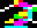 | `fighter_left_0` | 8×12 | [`sprite_fighter_left_0`](address:2720@disc?hex) |
| &44 |  | `fighter_left_1` | 8×12 | [`sprite_fighter_left_1`](address:2750@disc?hex) |
| &45 | 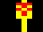 | `fireball_up` | 8×12 | [`sprite_fireball_up`](address:2780@disc?hex) |
| &46 |  | `fireball_right` | 8×12 | [`sprite_fireball_right`](address:27B0@disc?hex) |
| &47 | 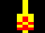 | `fireball_down` | 8×12 | [`sprite_fireball_down`](address:27E0@disc?hex) |
| &48 |  | `fireball_left` | 8×12 | [`sprite_fireball_left`](address:2810@disc?hex) |
| &49 |  | `sword_up` | 8×12 | [`sprite_sword_up`](address:1700@disc?hex) |
| &4A | 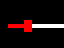 | `sword_right` | 8×12 | [`sprite_sword_right`](address:1730@disc?hex) |
| &4B |  | `sword_down` | 8×12 | [`sprite_sword_down`](address:1760@disc?hex) |
| &4C | 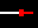 | `sword_left` | 8×12 | [`sprite_sword_left`](address:1790@disc?hex) |
| &4D |  | `axe_up` | 8×12 | [`sprite_axe_up`](address:2840@disc?hex) |
| &4E |  | `axe_right` | 8×12 | [`sprite_axe_right`](address:2870@disc?hex) |
| &4F |  | `axe_down` | 8×12 | [`sprite_axe_down`](address:28A0@disc?hex) |
| &50 |  | `axe_left` | 8×12 | [`sprite_axe_left`](address:28D0@disc?hex) |
| &51 |  | `exit` | 8×12 | [`sprite_exit`](address:22A0@disc?hex) |
| &52 |  | `key_icon` | 4×3 | [`sprite_key_icon`](address:22D0@disc?hex) |
| &53 |  | `drainer_0` | 8×12; *flashing* 8 (black/white), 15 (white/black) | [`sprite_drainer`](address:21D0@disc?hex) |
| &54 |  | `drainer_1` | 8×12; *flashing* 8 (black/white), 15 (white/black) | [`sprite_drainer`](address:21D0@disc?hex) |
| &55 |  | `drainer_2` | 8×12; *flashing* 8 (black/white), 15 (white/black) | [`sprite_drainer`](address:21D0@disc?hex) |
| &56 |  | `drainer_3` | 8×12; *flashing* 8 (black/white), 15 (white/black) | [`sprite_drainer`](address:21D0@disc?hex) |
| &57 |  | `drainer_4` | 8×12; *flashing* 8 (black/white), 15 (white/black) | [`sprite_drainer`](address:21D0@disc?hex) |
| &58 |  | `drainer_5` | 8×12; *flashing* 8 (black/white), 15 (white/black) | [`sprite_drainer`](address:21D0@disc?hex) |
| &59 |  | `drainer_6` | 8×12; *flashing* 8 (black/white), 15 (white/black) | [`sprite_drainer`](address:21D0@disc?hex) |
| &5A |  | `drainer_7` | 8×12; *flashing* 8 (black/white), 15 (white/black) | [`sprite_drainer`](address:21D0@disc?hex) |
| &5B |  | `drainer_8` | 8×12; *flashing* 8 (black/white), 15 (white/black) | [`sprite_drainer`](address:21D0@disc?hex) |
| &5C |  | `drainer_9` | 8×12; *flashing* 8 (black/white), 15 (white/black) | [`sprite_drainer`](address:21D0@disc?hex) |
| &5D |  | `drainer_10` | 8×12; *flashing* 8 (black/white), 15 (white/black) | [`sprite_drainer`](address:21D0@disc?hex) |
| &5E |  | `drainer_11` | 8×12; *flashing* 8 (black/white), 15 (white/black) | [`sprite_drainer`](address:21D0@disc?hex) |
| &5F |  | `boots` | 8×12 | [`sprite_boots`](address:0A00@disc?hex) |
| &60 |  | `helmet` | 8×12 | [`sprite_helmet`](address:0A30@disc?hex) |
| &61 |  | `potion` | 8×12 | [`sprite_potion`](address:0A60@disc?hex) |
| &62 |  | `weapons` | 8×12 | [`sprite_weapons`](address:0AC0@disc?hex) |
| &63 | 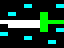 | `magic_sword` | 8×12; *flashing* 14 (cyan/red) | [`sprite_magic_sword`](address:0A90@disc?hex) |
| &64 |  | `skull_0` | 8×12 | [`sprite_skull_0`](address:19F0@disc?hex) |
| &65 |  | `skull_1` | 8×12 | [`sprite_skull_1`](address:1A20@disc?hex) |
| &66 |  | `skull_2` | 8×12 | [`sprite_skull_2`](address:1A50@disc?hex) |
| &67 |  | `skull_3` | 8×12 | [`sprite_skull_3`](address:1A80@disc?hex) |
| &68 |  | `skull_4` | 8×12 | [`sprite_skull_4`](address:1AB0@disc?hex) |
| &69 |  | `shield` | 6×12 | [`sprite_shield`](address:1800@disc?hex) |
| &6A |  | `small_digit_1` | 2×5 | [`sprite_small_digit_1`](address:1824@disc?hex) |
| &6B |  | `small_digit_2` | 2×5 | [`sprite_small_digit_2`](address:1829@disc?hex) |
| &6C |  | `small_digit_3` | 2×5 | [`sprite_small_digit_3`](address:182E@disc?hex) |
| &6D |  | `small_digit_4` | 2×5 | [`sprite_small_digit_4`](address:1833@disc?hex) |
| &6E |  | `small_digit_5` | 2×5 | [`sprite_small_digit_5`](address:1838@disc?hex) |
| &6F |  | `small_digit_6` | 2×5 | [`sprite_small_digit_6`](address:183D@disc?hex) |
| &70 |  | `small_digit_7` | 2×5 | [`sprite_small_digit_7`](address:1842@disc?hex) |
| &71 |  | `small_digit_8` | 2×5 | [`sprite_small_digit_8`](address:1847@disc?hex) |
| &72 |  | `small_digit_9` | 2×5 | [`sprite_small_digit_9`](address:184C@disc?hex) |
| &73 | 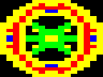 | `chalice` | 16×24; *flashing* 11 (yellow/blue), 12 (blue/yellow) | [`sprite_chalice`](address:1210@disc?hex) |
| &74 |  | `missile_icon` | 8×3 | [`sprite_missile_icon`](address:1860@disc?hex) |
| &75 |  | `boots_icon` | 4×6 | [`sprite_boots_icon`](address:186C@disc?hex) |
| &76 |  | `level_word` | 24×8 | [`sprite_level_word`](address:1878@disc?hex) |
| &77 |  | `blank_boots_icon` | 4×6 | [`sprite_blank`](address:04CF@disc?hex) |
